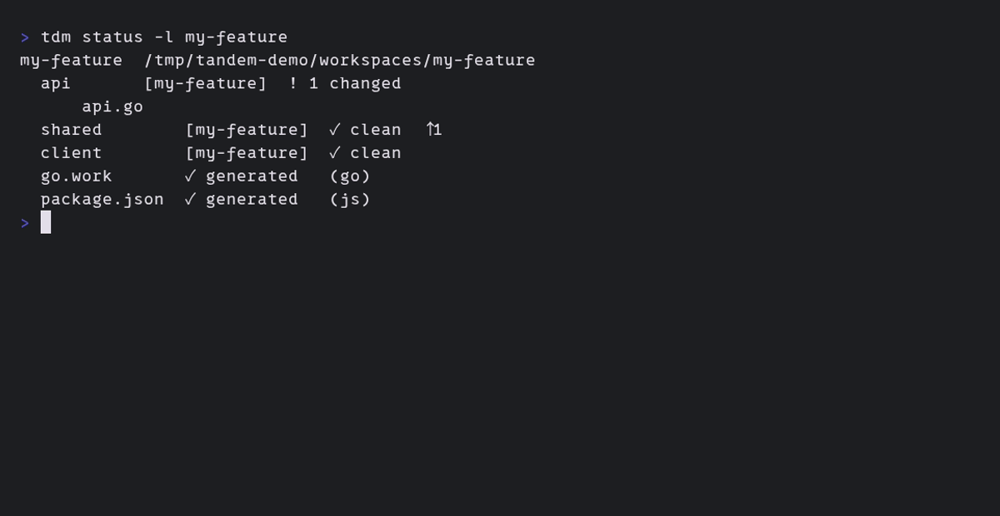
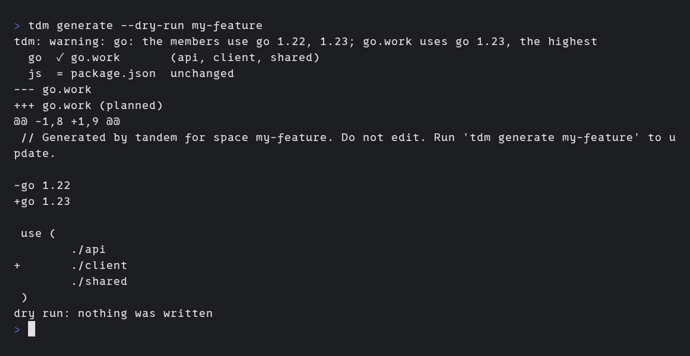
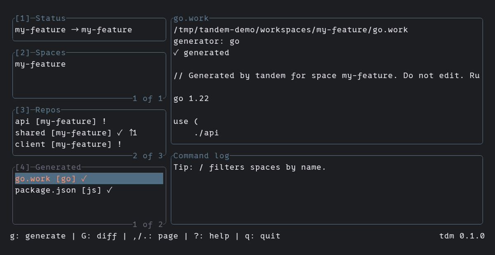

<p align="center">
  
</p>

<p align="center">
  <b>One feature branch across many repos.</b><br>
  A git worktree for each repo in one space directory, and the workspace files that connect their builds.
</p>

<p align="center">
  <a href="https://github.com/0mega24/tandem/actions/workflows/ci.yml"></a>
  <a href="CHANGELOG.md"></a>
  <a href="#generators"></a>
  <a href="go.mod"></a>
  <a href="flake.nix"></a>
  <a href="LICENSE"></a>
</p>

<p align="center">
  <a href="#why-tandem">Why tandem</a>
  &nbsp;&nbsp;|&nbsp;&nbsp;
  <a href="#see-it-work">See it work</a>
  &nbsp;&nbsp;|&nbsp;&nbsp;
  <a href="#install">Install</a>
  &nbsp;&nbsp;|&nbsp;&nbsp;
  <a href="#quick-start">Quick start</a>
  &nbsp;&nbsp;|&nbsp;&nbsp;
  <a href="#generators">Generators</a>
  &nbsp;&nbsp;|&nbsp;&nbsp;
  <a href="#configure">Configure</a>
  &nbsp;&nbsp;|&nbsp;&nbsp;
  <a href="#contributing">Contributing</a>
</p>

> [!NOTE]
> **tandem is in early development.** The commands work and have tests against the real build
> tools, but commands, config and state can still change before v1.

## Why tandem

A change can touch an API, a shared library and a client at once. You switch branches in each
repo, then wire the local copies into each build tool by hand: a `go.work` here, a Cargo
`[patch]` there, a pnpm workspace for the client. `tdm new` does all of it in one command, and
`tdm delete` takes it all away again. Your main clones stay where they are.

|                                                         | `git worktree` by hand | [wtg](https://github.com/geoffamey/wtg) | **tandem** |
|---------------------------------------------------------|:----:|:----:|:----:|
| One branch across many repos, in one directory          |  |  |  |
| A failed step undoes the steps before it                |  |  |  |
| Generated `go.work`                                     |  |  |  |
| Cargo, pnpm, Gradle, Maven, .NET, CMake, Meson, uv, Cabal |  |  |  |
| Repos that are already workspaces                       |  |  |  |
| Plugins for other build systems, in any language        |  |  |  |
| Terminal UI                                             |  |  |  |

tandem writes only the files it made and that nobody changed since. It does not build, install
or lock anything, and it does not replace the package manager of a language.

## See it work

The real `tdm` from `main`, recorded in a terminal ([tape](docs/demo/tandem.tape), `make demo`):

<p align="center">
  
</p>

### Every repo at a glance

`tdm status -l` shows the branch of each worktree, the changes, the commits that origin does not
have, and the state of each generated file.

<p align="center">
  
</p>

### See the plan before it is written

A new Go module in `client`? `tdm generate --dry-run` prints the rows and a diff of each file that
would change, and writes nothing. Without `--dry-run`, the files follow.

<p align="center">
  
</p>

### A terminal UI in the style of lazygit

`tdm ui` has numbered panels for the space, the spaces, the repos and the generated files, a main
view and a command log. It runs new, add, remove, delete, generate, sync and exec. Press `?` for
the keys. `enter` prints the path of the space, so `cd "$(tdm ui)"` goes there.

<p align="center">
  
</p>

## Install

### Nix

```sh
nix run github:0mega24/tandem -- version   # try it
nix profile install github:0mega24/tandem  # install it
```

<details>
<summary>Home Manager module</summary>

```nix
# flake.nix
inputs.tandem = {
  url = "github:0mega24/tandem";
  inputs.nixpkgs.follows = "nixpkgs";
};

# a Home Manager module with access to inputs
imports = [ inputs.tandem.homeManagerModules.default ];
programs.tandem = {
  enable = true;
  settings.discovery.root_dir = "~/repos";
};
```

The `tcd <space>` shell function (on by default) changes to the space directory.
See the [module options](nix/hm-module.nix).

</details>

<details>
<summary>NixOS module</summary>

With the same flake input:

```nix
imports = [ inputs.tandem.nixosModules.default ];
programs.tandem = {
  enable = true;
  settings.discovery.root_dir = "~/repos";
};
```

The settings go in `/etc/xdg/tandem/config.toml`; user config overrides them.
See the [module options](nix/nixos-module.nix).

</details>

### Packages

Each `v*` tag publishes a GitHub release with .deb, .rpm and pacman packages and tarballs for
Linux and macOS (amd64 and arm64), with shell completions. Download the file from the
[releases page](https://github.com/0mega24/tandem/releases), then:

```sh
sudo apt install ./tandem_*_amd64.deb              # Debian, Ubuntu
sudo dnf install ./tandem-*.x86_64.rpm             # Fedora, RHEL
sudo pacman -U ./tandem-*-x86_64.pkg.tar.zst       # Arch, Artix
sha256sum --check --ignore-missing checksums.txt   # check the download first
```

### Go

```sh
go install github.com/0mega24/tandem/cmd/tdm@latest   # needs Go 1.27
```

### From source

```sh
git clone https://github.com/0mega24/tandem && cd tandem
make build && ./bin/tdm version   # enters the Nix dev shell when needed
make install                      # to ~/.local/bin (PREFIX=... to change)
nix build                         # or: the Nix package in result/bin/tdm
```

Without Nix, `make build DEV=` uses the Go on your PATH.

## Quick start

Put your main clones under `~/repos`, or set `discovery.root_dir`.

```sh
tdm config init                       # write the user config
tdm repo sync                         # fast-forward the default branches first
tdm new my-feature api shared client  # one worktree on my-feature in each repo
tcd my-feature                        # or: cd "$(tdm path my-feature)"
tdm add my-feature web                # add a repo later; the generated files follow
tdm exec my-feature -- git push -u origin my-feature
tdm delete -d my-feature              # remove it all, and the merged branches
```

| Command | Does |
|---|---|
| `tdm new <space> <repo>...` | Make the space: a worktree on one branch in each repo, then the generators |
| `tdm add` / `tdm remove` | Change the repos of a space; the generated files follow |
| `tdm exec <space> -- <cmd>` | Run a command in each worktree |
| `tdm generate [-n] <space>` | Write the workspace files again; `-n` shows a diff only |
| `tdm delete [-d\|-D] <space>` | Remove the worktrees, the files and the space; asks before it drops unpushed work |
| `tdm status [-l]`, `tdm path` | Inspect a space; print its directory |
| `tdm repo status`, `tdm repo sync` | Inspect and update the main clones |
| `tdm ui` | The terminal UI |
| `tdm import wtg [--dry-run]` | Copy your wtg spaces and config; changes nothing in the worktrees |

A new branch starts from the local default branch, so run `tdm repo sync` first. An existing
branch is checked out as it is. `--branch NAME` and `--path DIR` change the branch and directory.

## Generators

Each generator finds its manifests in the worktrees and writes files in the space root.
`tdm generate --list` shows them. `--generate=go,rust` or `--no-generate` on `tdm new` picks the
set for one space; `generate.enabled` in the config picks it for all. Every generator has an
integration test that runs the real tool (`make test-integration` in `nix develop .#integration`).

| Language / tool | Files written | Default |
|---|---|:---:|
| Go | `go.work` | on |
| Rust | `.cargo/config.toml` `[patch]` tables, or a root `Cargo.toml` workspace | on |
| JavaScript / TypeScript | `pnpm-workspace.yaml` or `package.json` workspaces | on |
| Java / Kotlin / Groovy / Scala (Gradle) | `settings.gradle.kts` composite build | on |
| Java (Maven) | `pom.xml` aggregator | on |
| C# / F# / VB (.NET) | `<space>.slnx` or `<space>.sln` | on |
| C / C++ (CMake) | `.tandem/cmake/overrides.cmake` | on |
| C / C++ (Meson) | `subprojects/<dir>` links in the consumer worktrees | on |
| Haskell (Cabal) | `cabal.project` | on |
| TypeScript project references | `tsconfig.json` | off |
| Python (uv) | `pyproject.toml` workspace | off |
| VS Code | `<space>.code-workspace` | off |

The options of each generator are in [docs/generators.md](docs/generators.md).
A .NET solution groups projects; it does not turn package references into project references.
Meson needs `subprojects/<dir>` to be git-ignored in the consumer.

### Plugins

A build system that tandem does not know? Write an executable `tdm-gen-<id>` in any language. It
reads a JSON request on stdin and answers with the files to write. tandem applies the plan with
its ownership checks and undo steps, so a plugin never writes files itself. `tdm plugin check <id>`
tests one. See the [plugin protocol](docs/plugins.md) and the [example plugins](examples/plugins)
(Zig in shell, Bundler in Python). To add a built-in generator,
`make newgen ID=zig MANIFEST=build.zig.zon` writes the package and its golden tests.

## Configure

Later layers override earlier ones: the built-in defaults, `tandem/config.toml` in each
`$XDG_CONFIG_DIRS` directory, `$XDG_CONFIG_HOME/tandem/config.toml`, then `TDM_CONFIG` or
`--config`. YAML works too, and unknown keys are errors. `tdm config` prints the files it read.

```toml
[discovery]
root_dir = "~/repos"       # where the main clones are
max_depth = 2

[spaces]
root_dir = "~/workspaces"

[always]                   # applied by tdm new
repos = []                 # linked into each space, not branched
files = []                 # copied into the space root
secrets = []               # for example ".env", copied into each worktree
run = ""                   # hook after new, add, remove and delete

[generate]
# enabled = ["go", "rust"] # default: the generators marked "on"; ["none"] for none
```

`tdm config init` writes the file with a `#:schema` line for
[schema/config.schema.json](schema/config.schema.json), so editors with Taplo complete the keys.

### Agent skills

Two skills teach coding agents to use tandem: `tandem` (work in a space) and `tandem-setup`
(set up tandem for a person).

```sh
claude plugin marketplace add 0mega24/tandem && claude plugin install tandem@tandem
codex plugin marketplace add 0mega24/tandem
```

## Contributing

Use `nix develop` or direnv; the Makefile enters the dev shell when needed.

```sh
make build               # bin/tdm
make test                # unit, golden and testscript tests
make check               # the merge gate: what CI runs
make test-integration    # the real build tools (in nix develop .#integration)
make snapshot            # release packages in dist/, nothing published
```

Read [AGENTS.md](AGENTS.md) for the repo rules, [docs/DESIGN.md](docs/DESIGN.md) for the
structure and prior art, and [docs/spec/](docs/spec/) for the requirements. User-visible changes
go in [CHANGELOG.md](CHANGELOG.md).

## Acknowledgements

Tandem is inspired by [wtg](https://github.com/geoffamey/wtg) by Geoff Amey, which showed the idea
of one branch across many repos as git worktrees, with a generated go.work.
Tandem is a new implementation. It is not based on wtg code.

## License

MIT. See [LICENSE](LICENSE).
