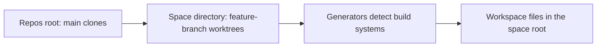

# Tandem

One feature branch across many repos, with git worktrees in one space and workspace files that
connect their build systems.

[](https://github.com/0mega24/tandem/actions/workflows/ci.yml)
[](LICENSE)
[](go.mod)

> [!NOTE]
> Tandem is in early development. Today, `tdm` can make a space (`new`, with the `always.*`
> links and copies), add and remove repos, delete it, print its path and status, show and sync
> the main clones, run a command in each worktree, run the `always.run` hook, and print its
> config. Workspace generators, the TUI, and plugins are planned.

## Why

A feature can need changes in an API, a shared library, and a client at the same time.
Switching branches in each repo and setting up local dependencies takes separate steps.

Tandem aims to put those changes in one space: each repo gets a worktree on the feature branch,
and workspace files connect the local source for each build system. Main clones stay in place.
Today, repo status and sync help you inspect and update those main clones from one command.

## How it works

Today, `tdm new` makes the worktrees and writes `go.work` for the Go repos; `tdm add`,
`tdm remove` and `tdm generate` write it again, and `tdm delete` deletes it. The other generators are **planned**:



Example of the files on disk for two Go repos:

```text
~/repos/                       # existing main clones
├── api/
└── shared/
~/workspaces/my-feature/       # tdm new my-feature api shared
├── api/                       # worktree on my-feature
├── shared/                    # worktree on my-feature
└── go.work                    # tdm generate my-feature: local module links
```

Generators will use each build tool's workspace or local override mechanism. They will not build,
install, or lock dependencies. Most generated files will stay in the space root; Meson will use
ignored symlinks inside consumer worktrees. See the [generator spec](docs/spec/generators.md).

## Install

With Nix flakes:

```sh
nix run github:0mega24/tandem -- version
nix profile install github:0mega24/tandem
```

<details>
<summary>Home Manager</summary>

Add the input to your configuration flake:

```nix
inputs.tandem = {
  url = "github:0mega24/tandem";
  inputs.nixpkgs.follows = "nixpkgs";
};
```

In a Home Manager module with access to `inputs`:

```nix
imports = [ inputs.tandem.homeManagerModules.default ];
programs.tandem = {
  enable = true;
  settings.discovery.root_dir = "~/repos";
};
```

The `tcd <space>` shell helper (on by default) changes to the space directory.
See the [module options](nix/hm-module.nix).

</details>

<details>
<summary>NixOS</summary>

Add the same `inputs.tandem` flake input shown above. In a NixOS module with access to `inputs`:

```nix
imports = [ inputs.tandem.nixosModules.default ];
programs.tandem = {
  enable = true;
  settings.discovery.root_dir = "~/repos";
};
```

Settings go in `/etc/xdg/tandem/config.toml`. User config overrides them.
See the [module options](nix/nixos-module.nix).

</details>

<details>
<summary>From source</summary>

In a checkout of this repo:

```sh
make build                 # enters the Nix dev shell when needed
./bin/tdm version
```

Or use `nix build` to get `result/bin/tdm`.

</details>

## Quick start

Put your main clones under `~/repos`, or set `discovery.root_dir` in your config.

```sh
tdm version
tdm config path            # find the user config file
tdm config init            # write it, with the generator settings as comments
tdm config                 # print the config files read, lowest priority first
tdm repo status            # inspect all main clones
```

With the three clean clones from the [command test](internal/cli/testdata/script/repo.txtar),
`tdm repo status` prints:

```text
api        main  ✓ clean
myorg/api  main  ✓ clean
web        main  ✓ clean
```

Select repos by their path under the root, or by the last part when it is unique:

```sh
tdm repo status -l web     # also show the origin URL and path
tdm repo status myorg/api
tdm repo sync              # fetch and fast-forward default branches
tdm repo sync web          # sync only this clone
tdm completion bash        # print a completion script; zsh and fish also work
```

Sync skips clones with local changes and default branches checked out in a worktree.
It does not touch worktrees. Discovery excludes linked worktrees and does not follow symlinks.

Make a space with a worktree on branch `feat` in three repos (output from the
[space test](internal/cli/testdata/script/space.txtar)):

```text
$ tdm new feat api web lib
feat         ~/workspaces/feat
  api        ✓ worktree  [feat]  new branch from main
  web        ✓ worktree  [feat]  existing branch
  myorg/lib  ✓ worktree  [feat]  new branch from main
  cabal      - no members
  cmake      - no members
  dotnet     - no members
  go         - no members
  gradle     - no members
  js         - no members
  maven      - no members
  meson      - no members
  rust       - no members

$ tdm status feat
feat         ~/workspaces/feat
  api        [feat]  ! 1 changed
  web        [feat]  ✓ clean  ↑1
  myorg/lib  [feat]  ✓ clean

$ cd "$(tdm path feat)"    # or: tcd feat
```

If you delete a worktree with `rm`, the next command prunes it in git and takes it out of the
space, with a warning. Its commits stay on the branch.

A new branch starts from the local default branch, so run `tdm repo sync` first. An existing
branch is checked out as it is. `--branch NAME` and `--path DIR` change the branch and the
directory. `--generate=go` or `--no-generate` chooses the generators for this space in place of
`generate.enabled`. When a step fails, `tdm new` undoes the steps before it.

## Configuration

Tandem loads these layers in order. Later values override earlier values:

1. Built-in defaults.
2. `tandem/config.toml` in each directory of `$XDG_CONFIG_DIRS` (default `/etc/xdg`).
   The first directory has the highest priority.
3. `$XDG_CONFIG_HOME/tandem/config.toml` (default `~/.config/tandem/config.toml`).
4. The file set by `TDM_CONFIG`, or by `--config` if both are set.

Each config directory uses `config.toml`, or `config.yaml` if no TOML file exists.
Explicit files ending in `.yaml` or `.yml` use YAML; other extensions use TOML.
Missing system and user files are allowed. A missing explicit file or an unknown key is an error.
`tdm config init` starts the file with a `#:schema` line for
[schema/config.schema.json](schema/config.schema.json), so editors with Taplo complete and check
the keys. [docs/generators.md](docs/generators.md) lists the generators and their options.

This TOML example uses the current defaults:

```toml
[discovery]
root_dir = "~/repos"
max_depth = 2

[spaces]
root_dir = "~/workspaces"

[git]
branch_prefix = ""

[always]
repos = []
files = []
secrets = []
run = ""
```

`discovery.max_depth` counts directory levels below the root; `1` scans direct children only.
`tdm new` uses the `always` keys:

- `repos`: each repo that is not on the command line becomes a symlink to its main clone. It has
  no branch, and its edits show in all spaces.
- `files`: absolute paths (or `~/`) copied into the space root by base name, e.g. `AGENTS.md`.
- `secrets`: paths relative to each repo, e.g. `.env`, copied from the main clone into its
  worktree with the same mode. A repo that does not have one is skipped.

- `run`: an executable (absolute, `~/`, or a name on `PATH`) that runs in the space root after
  `new`, `add`, `remove` and `delete`. It gets `TDM_SPACE_NAME`, `TDM_SPACE_ROOT`,
  `TDM_SPACE_BRANCH`, `TDM_SPACE_EVENT` (`create`, `add`, `remove`, `delete`), and the lists
  `TDM_REPOS`, `TDM_REPO_PATHS`, `TDM_EVENT_REPOS` and `TDM_GENERATED_FILES` (one entry per
  line). Its output goes to
  stderr. A failure is a warning: the command still succeeds.

The `[generate]` table chooses the generators: `enabled = ["go"]` (or `["none"]`) and
`detect_depth`. `tdm generate --list` shows the generators and their defaults.
See the [config types and defaults](internal/config/config.go).

## Planned

Generators will update the workspace files when the member repos change. Go is available through
`tdm generate`; the other entries below are planned. Release numbers are targets from the spec.

| Language / tool | Files written | Release |
|---|---|---|
| Go | `go.work` | 1 |
| Rust | `Cargo.toml` workspace or `.cargo/config.toml` patches | 1 |
| JavaScript / TypeScript | `pnpm-workspace.yaml` or `package.json` | 1 |
| TypeScript references | `tsconfig.json` (off by default) | 1 |
| Java / Kotlin / Groovy / Scala (Gradle) | `settings.gradle.kts` | 1 |
| Java / Kotlin (Maven) | `pom.xml` aggregator | 1 |
| C# / F# / VB (.NET) | `<space>.slnx` or `<space>.sln` | 1 |
| C / C++ (CMake) | `.tandem/cmake/overrides.cmake` | 1 |
| C / C++ (Meson) | `subprojects/<dir>` symlinks in consumer worktrees | 1 |
| Python (uv) | `pyproject.toml` (off by default) | 1 |
| Haskell (Cabal) | `cabal.project` | 2 |
| VS Code | `<space>.code-workspace` (off by default) | 2 |

A .NET solution will group projects; it will not replace package references with project references.
See the [generator requirements](docs/spec/generators.md#generators-by-language).

The planned `tdm ui` will provide a lazygit-style TUI with Spaces, Repos, Details, and a log.
See the [TUI design](docs/DESIGN.md#tui).

External generator plugins are planned. Executables named `tdm-gen-<id>` will
exchange JSON requests and plans with Tandem. Tandem will write the files and handle ownership
checks and rollback. A planned `tdm import wtg` command will import existing wtg state and config.
See the [plugin protocol](docs/spec/project.md#external-generator-plugins) and
[migration plan](docs/spec/project.md#migration-from-wtg).

## Development

Use `nix develop` or direnv (`.envrc` uses the flake). The Makefile also enters the dev shell.

| Command | Purpose |
|---|---|
| `make build` | Build `bin/tdm` |
| `make test` | Run tests; use `RUN=regex` to filter |
| `make lint` | Check Go, Nix, and GitHub Actions |
| `make fmt` / `make fmt-check` | Format files / check formatting |
| `make check` | Run the merge gate |
| `make clean` | Remove build output |

Read [AGENTS.md](AGENTS.md) for repo rules and [docs/DESIGN.md](docs/DESIGN.md) for the structure,
prior art, and changes from the specs. See [CHANGELOG.md](CHANGELOG.md) for current changes.

## Acknowledgements

Tandem is inspired by [wtg](https://github.com/geoffamey/wtg) by Geoff Amey, which showed the idea
of one branch across many repos as git worktrees, with a generated go.work.
Tandem is a new implementation. It is not based on wtg code.

## License

MIT. See [LICENSE](LICENSE).
